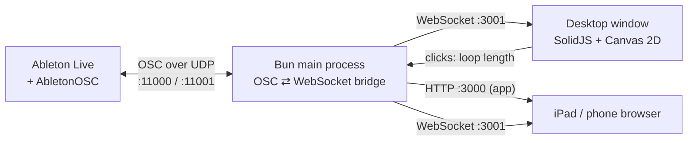

# Loop View — Ableton Loop Visualizer

**[▶ Live demo](https://loop-view.idevandyou.workers.dev)** — runs in the browser on simulated playback, no Ableton needed.

Loop View shows every clip playing in your Ableton Live session as a Loopy-Pro-style spinning ring, on your desktop or on an iPad over Wi-Fi.

## Why
Ableton's native loop UX is painful to live with when you perform: no per-clip playhead, no session-wide view of where each loop is. Loop View shows every playing clip's phase, length and color at a glance.

## How it works

- **Bun + Electrobun** — one TypeScript codebase for the desktop shell and the bridge; system webview, small bundle.
- **SolidJS + Canvas 2D** — UI state in signals; the 60 fps render loop reads playheads from a plain buffer, bypassing reactivity.
- **AbletonOSC listeners** — Live pushes tempo, beat and clip positions; rings follow Live's clock, not a local timer.

## Run it

1. Install [AbletonOSC](https://github.com/ideoforms/AbletonOSC) (Live 11+) and select it under **Settings → Link, Tempo & MIDI → Control Surface**.
2. `bun install && bun run start` — the desktop window connects to Live.
3. On an iPad on the same Wi-Fi, open `http://<your-mac-ip>:3000`. The LAN server has no authentication yet — use it on a network you trust (#22).

No Ableton? `bun run dev:web` and open `http://localhost:5173/?demo`.

## Develop

| Command | What |
|---|---|
| `bun run check` | Typecheck |
| `bun run test` | Unit tests (OSC codec, timing, color, loop lengths) |
| `bun run audit` | Dependency vulnerability gate |
| `bun run deploy:web` | Build and deploy the public demo to Cloudflare |

Dependencies must be at least 7 days old to install (`bunfig.toml`).
